# Laporan Tugas Minggu 11: Authentication System CodeIgniter 4 (ShopEase)

**Mata Kuliah:** Pemrograman Berbasis Kerangka Kerja (PBKK)  
**Nama:** Farrel Prastita Ramadhan  
**NRP:** 5025241219  
**Program Studi:** Teknik Informatika, Institut Teknologi Sepuluh Nopember (ITS)  
**Materi:** Hands-On Lab — Authentication System menggunakan CodeIgniter 4 (Studi Kasus ShopEase Online Store)  
**Teknologi:** CodeIgniter 4.7.6 · PHP 8.2+ · SQLite3 / MySQL (`db_shopease`) · Bootstrap 5 · Chart.js

---

## 1. Deskripsi Singkat

**ShopEase** adalah aplikasi toko online berbasis arsitektur MVC CodeIgniter 4. Pada Minggu 11 dibangun modul **Authentication & Authorization System** lengkap meliputi registrasi customer, login, logout, manajemen session, kontrol akses berbasis peran (**RBAC**), serta proteksi route menggunakan **Filter** (`AuthFilter`, `GuestFilter`, `RememberMeFilter`, dan global `CSRF`).

| Peran (Role) | Tujuan Redirect Login | Hak Akses Utama |
| :--- | :--- | :--- |
| **Customer** | `/` (Storefront) | Beranda belanja, profil akun & ganti password, keranjang (`/keranjang`), dan riwayat pesanan (`/pesanan`). |
| **Admin** | `/admin` | Dashboard statistik & grafik registrasi 7 hari, Kelola User & Role (`/admin/users`), serta akses penuh panel Operator. |
| **Operator** | `/operator` | Dashboard Operator (`/operator`) untuk antrean pemenuhan pesanan, ditambah manajemen profil sendiri. |

Antarmuka dirancang dengan identitas visual **ShopEase** (palet ungu `#6d28d9`, ikon tas belanja SVG, tipografi *Plus Jakarta Sans*, layout login/registrasi dua kolom, storefront modern, dan panel Admin/Operator ber-sidebar) di atas Bootstrap 5 dan custom stylesheet [`shopease/public/assets/css/shopease.css`](shopease/public/assets/css/shopease.css).

---

## 2. Alur Proses Autentikasi & Otorisasi

```text
User ──▶ Form Registrasi / Login (CSRF) ──▶ AuthController ──▶ service('auth') ──▶ UserModel ──▶ Database (users)
 ▲                                                                                                      │
 └──────────────── redirect sesuai role / intended_url ◀──── Session (isLoggedIn, id_user, name, role) ◀┘

Request berikutnya:
Router ──▶ RememberMeFilter ──▶ AuthFilter (cek session & role) ──▶ Controller ──▶ View
```

- **Registrasi (`AuthController::store`)**: Validasi nama, email unik (`is_unique[users.email]`), panjang password min. 8 karakter + konfirmasi. Password di-hash dengan `password_hash($password, PASSWORD_BCRYPT)` sebelum disimpan dengan peran `customer`.
- **Login (`AuthController::authenticate`)**: Menggunakan `service('auth')->attempt()` yang menerapkan **anti brute force** (`Throttler` maks 5 percobaan/menit per IP+email) dan `password_verify()`. Pesan kegagalan bersifat generik agar tidak membocorkan apakah email terdaftar atau tidak. Bila cocok, `session()->regenerate(true)` dijalankan.
- **AuthFilter (`app/Filters/AuthFilter.php`)**: Memeriksa `isLoggedIn` (atau memulihkan sesi lewat cookie Remember Me yang valid), menyimpan `intended_url` untuk tamu, serta mengecek argumen role seperti `auth:admin` dan `auth:operator,admin`.
- **Logout (`AuthController::logout`)**: Menghapus token `auth_tokens` di database, menghapus cookie Remember Me, membersihkan session login, dan meregenerasi ID session.

---

## 3. Tahapan Praktikum & Pengembangan Tambahan

### 3.1 Tahapan Inti Hands-On Lab

| No | Tahapan Lab | File Implementasi |
| :-: | :--- | :--- |
| 1 | Database & tabel `users` + `auth_tokens` | [`CreateUsers.php`](shopease/app/Database/Migrations/2026-11-10-000001_CreateUsers.php), [`CreateAuthTokens.php`](shopease/app/Database/Migrations/2026-11-10-000002_CreateAuthTokens.php), [`database/db_shopease.sql`](shopease/database/db_shopease.sql) |
| 2 | Konfigurasi koneksi `.env` | [`shopease/.env.example`](shopease/.env.example) (SQLite3 aktif default, konfigurasi MySQL `db_shopease` siap pakai) |
| 3 | Model `UserModel` & `AuthTokenModel` | [`UserModel.php`](shopease/app/Models/UserModel.php), [`AuthTokenModel.php`](shopease/app/Models/AuthTokenModel.php) |
| 4 | Controller `AuthController` | [`AuthController.php`](shopease/app/Controllers/AuthController.php) (`register`, `store`, `login`, `authenticate`, `logout`) |
| 5 | Konfigurasi Routes & Filter | [`Routes.php`](shopease/app/Config/Routes.php), [`Filters.php`](shopease/app/Config/Filters.php) |
| 6 | View Login & Registrasi dua kolom | [`layouts/auth.php`](shopease/app/Views/layouts/auth.php), [`auth/login.php`](shopease/app/Views/auth/login.php), [`auth/register.php`](shopease/app/Views/auth/register.php) |
| 7 | Proteksi `AuthFilter` & `GuestFilter` | [`AuthFilter.php`](shopease/app/Filters/AuthFilter.php), [`GuestFilter.php`](shopease/app/Filters/GuestFilter.php) |

### 3.2 Pengembangan Lanjutan di Luar Lab

| Fitur | Implementasi Teknis |
| :--- | :--- |
| **Service Auth Terpusat** | [`App\Libraries\Auth`](shopease/app/Libraries/Auth.php) didaftarkan di [`Services.php`](shopease/app/Config/Services.php), dipanggil melalui `service('auth')`. |
| **Ingat Saya (30 Hari)** | Pola *selector + validator*: validator disimpan sebagai hash `SHA-256` di tabel `auth_tokens`, dirotasi setiap kali memulihkan sesi, dan dicabut saat logout atau ganti password. |
| **Anti Brute Force** | Menggunakan `service('throttler')` dengan batas 5 percobaan gagal per 60 detik untuk setiap kombinasi IP + email. |
| **Intended URL Redirect** | Tamu yang mengakses `/keranjang` diarahkan ke `/login`, lalu otomatis dikembalikan ke `/keranjang` setelah berhasil login. |
| **GuestFilter** | Mencegah pengguna yang sudah login membuka `/login` atau `/register`. |
| **Profil Saya & Ganti Password** | [`ProfileController.php`](shopease/app/Controllers/ProfileController.php) mendukung pembaruan nama/telepon/alamat serta penggantian password (wajib verifikasi password lama + revoke token). |
| **Kelola User & Role (Admin)** | [`Admin/UserController.php`](shopease/app/Controllers/Admin/UserController.php): pencarian, filter role, tambah akun staf/customer, ubah role, hapus user, dengan proteksi admin tidak dapat mengubah/menghapus akunnya sendiri. |
| **Dashboard Admin (Chart.js)** | [`Admin/DashboardController.php`](shopease/app/Controllers/Admin/DashboardController.php): statistik jumlah user per role, token aktif, daftar user terbaru, dan grafik registrasi 7 hari terakhir. |

---

## 4. Verifikasi Route, Database, dan Hash Password

Output asli dari `php spark routes` dan query tabel `users` (termasuk akun baru hasil registrasi `farrel.uji@shopease.local` yang tersimpan dalam hash `$2y$10$...` bcrypt serta pembersihan `auth_tokens` saat logout):

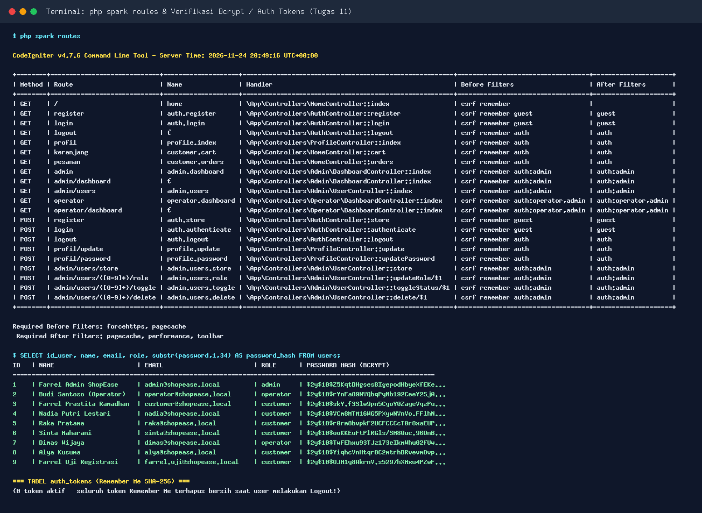

---

## 5. Skenario Pengujian & Screenshot Hasil Aplikasi

| No | Skenario Pengujian | Hasil Aktual | Bukti Screenshot |
| :-: | :--- | :--- | :--- |
| 1 | Membuka beranda sebagai tamu | Storefront tampil dengan tombol Masuk/Daftar | `01-storefront-tamu.png` |
| 2 | Mengisi form registrasi customer baru | Validasi & hashing bcrypt berjalan | `02-halaman-registrasi.png` |
| 3 | Submit registrasi `farrel.uji@shopease.local` | Redirect `302 -> 200` ke `/login` + flash sukses | `03-registrasi-berhasil.png` |
| 4 | Login dengan password salah | Ditolak dengan pesan error generik | `04-login-gagal.png` |
| 5 | Tamu mengakses `/keranjang` | `AuthFilter` menolak & redirect ke `/login` + simpan intended URL | `05-tamu-ke-keranjang-redirect.png` |
| 6 | Login customer + centang Remember Me | Berhasil masuk dan langsung diarahkan ke `/keranjang` | `06-customer-intended-keranjang.png` |
| 7 | Mengakses `/profil` sebagai customer | Tampil data akun, form edit profil & ganti password | `07-profil-customer.png` |
| 8 | Customer mencoba mengakses `/admin` | `AuthFilter (auth:admin)` menolak & redirect ke `/` dengan alert merah | `08-customer-ditolak-admin.png` |
| 9 | Login sebagai `admin@shopease.local` | Redirect ke `/admin` menampilkan statistik & grafik Chart.js | `09-admin-dashboard.png` |
| 10 | Mengelola user & role di `/admin/users` | Daftar 9 user tampil, akun admin sendiri dilindungi | `10-admin-kelola-users.png` |
| 11 | Login sebagai `operator@shopease.local` | Redirect ke `/operator` menampilkan antrean pemenuhan | `11-operator-dashboard.png` |
| 12 | Logout via POST `/logout` (CSRF) | Session & token Remember Me dihapus, redirect ke `/login` | `12-logout-berhasil.png` |

### 5.1 Storefront Tamu & Alur Registrasi
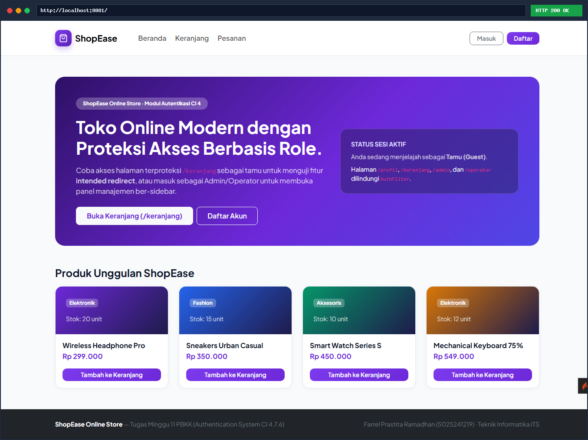
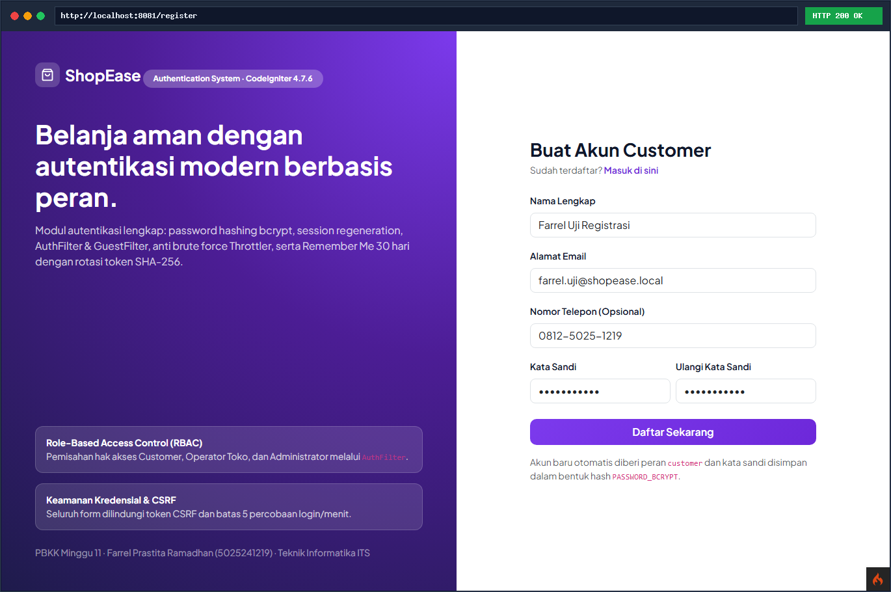


### 5.2 Pengujian Login Gagal, AuthFilter & Intended Redirect
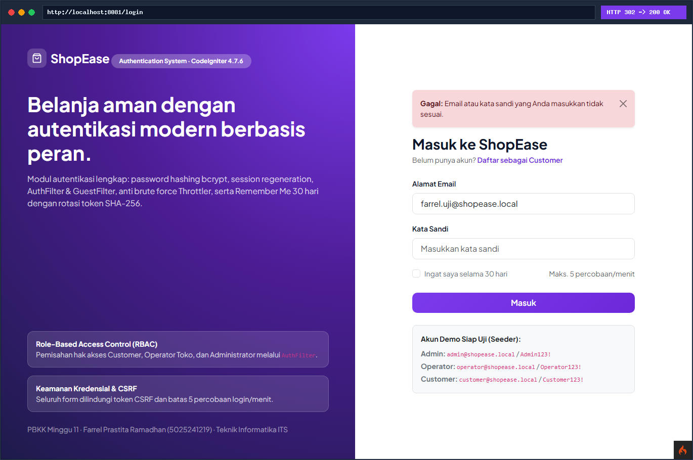
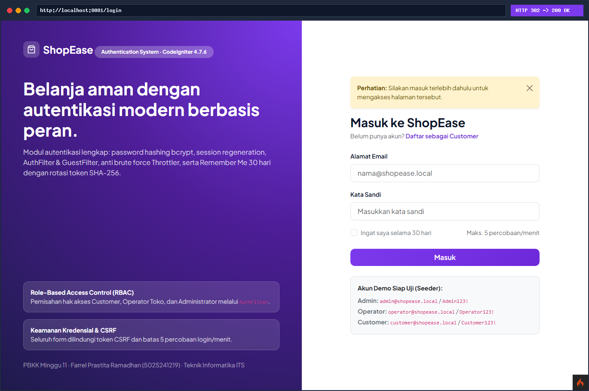
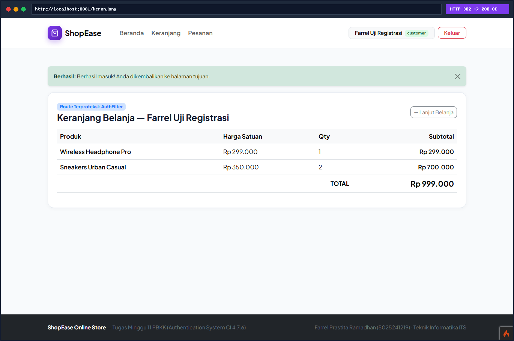

### 5.3 Profil Customer & Penolakan Akses Lintas-Role (`/admin`)
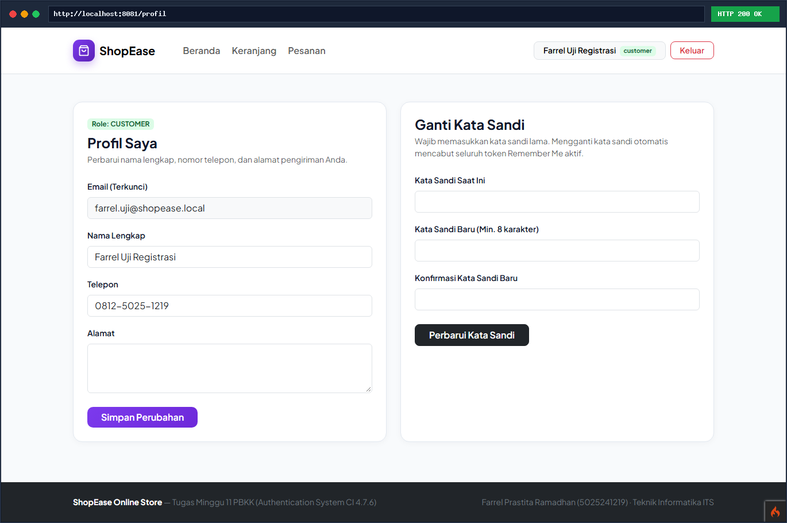
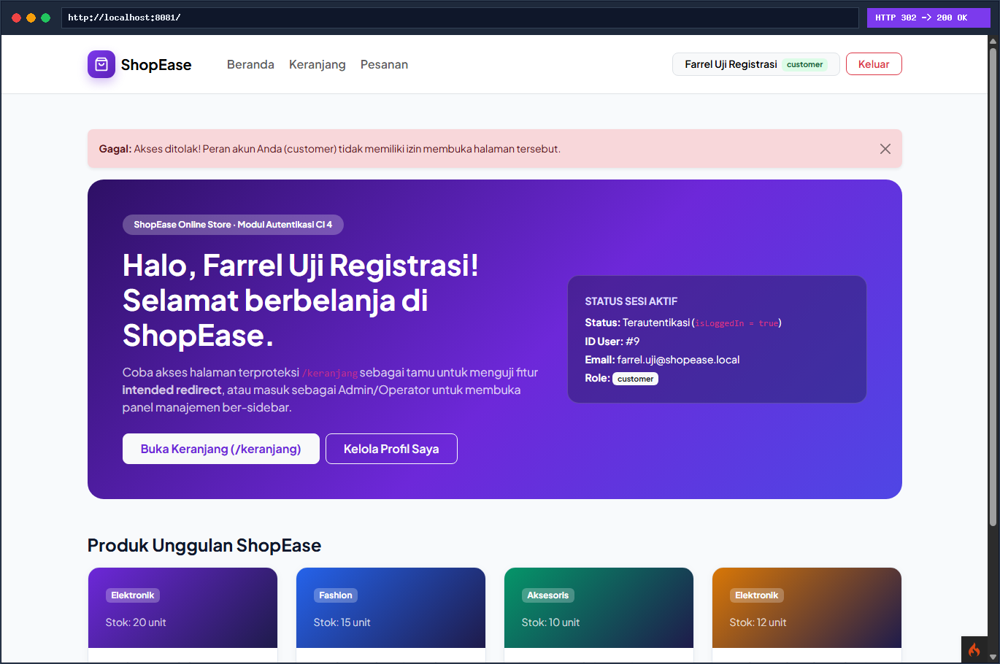

### 5.4 Panel Administrator (Chart.js & Kelola User) dan Panel Operator
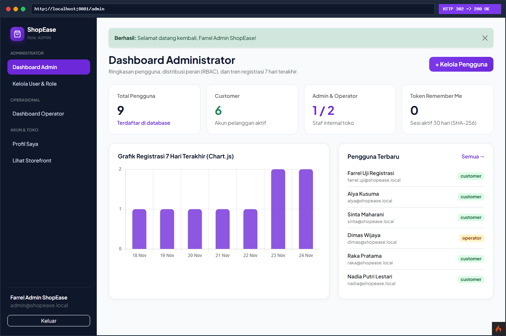
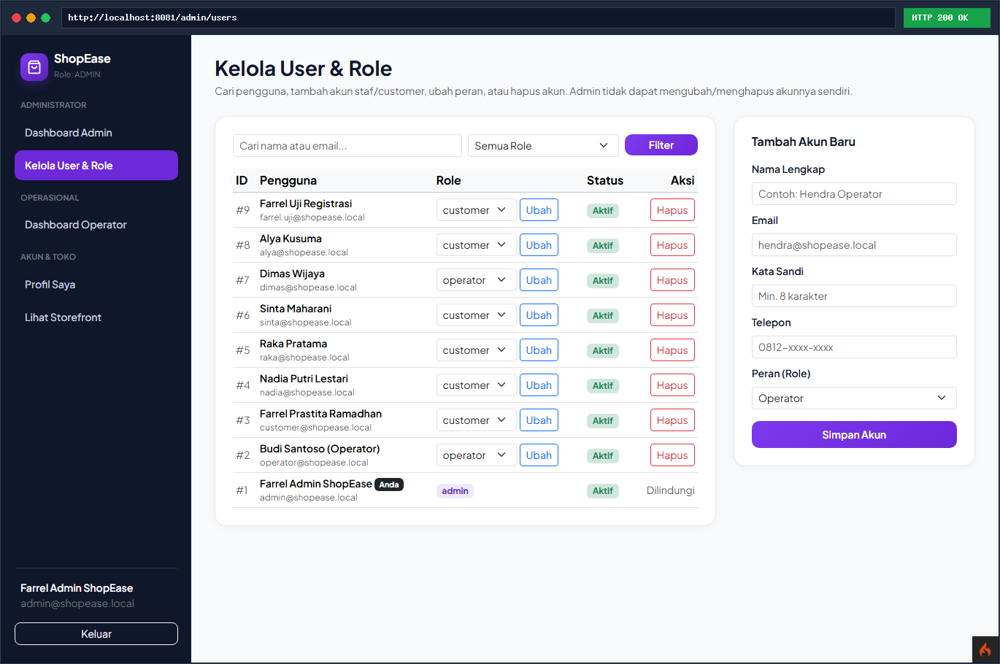
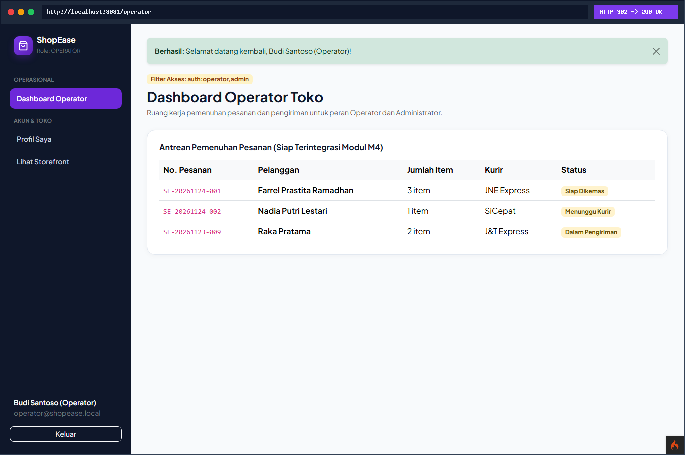

### 5.5 Logout Aman
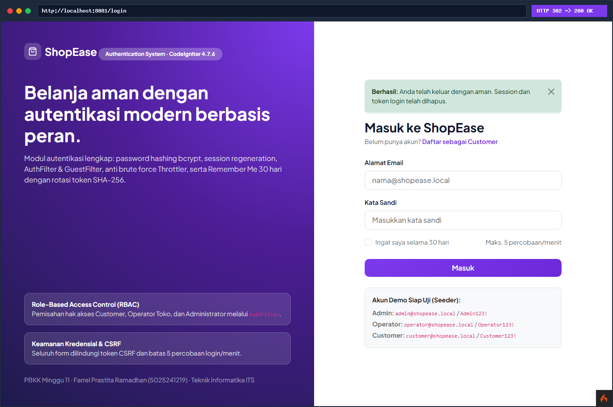

---

## 6. Akun Demo & Cara Menjalankan Lokal

| Role | Email | Password |
| :--- | :--- | :--- |
| Admin | `admin@shopease.local` | `Admin123!` |
| Operator | `operator@shopease.local` | `Operator123!` |
| Customer | `customer@shopease.local` | `Customer123!` |

```powershell
cd shopease
composer install
cp .env.example .env
php spark migrate
php spark db:seed UserSeeder
php spark serve --port 8081
```
*(Di Windows dengan XAMPP, dapat juga langsung menjalankan `.\serve.bat`.)*

